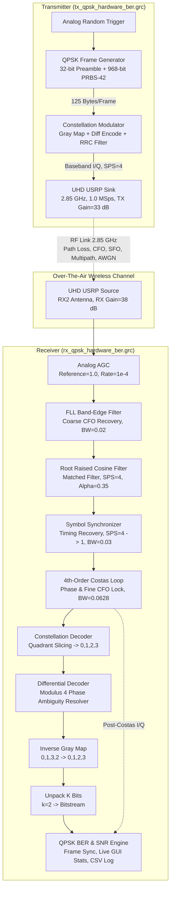

# Comprehensive USRP B210 QPSK Over-The-Air (OTA) Hardware Tuning & Locking Guide

This guide provides the complete mathematical principles, DSP block configuration, sequential slider tuning procedure, and visual constellation diagnostic signatures for operating the QPSK transceiver system over the air using Ettus USRP B210 SDRs in GNU Radio 3.10.

---

## 1. System Architecture & Theory of Operation

### 1.1 Transceiver Flowgraph Summary



---

## 2. Hardware Non-Idealities & Countermeasures

| Hardware / Channel Impairment | Physical Cause on USRP B210 | DSP Countermeasure in Flowgraph |
| :--- | :--- | :--- |
| **Carrier Frequency Offset (CFO)** | Local oscillator (LO) crystal ppm offset between TX and RX boards ($\Delta f \approx \pm 10\text{ to }30\text{ kHz}$ at 2.85 GHz). | **FLL Band-Edge Filter** for coarse frequency capture ($\pm 50\text{ kHz}$) followed by **4th-Order Costas Loop** for fine carrier phase tracking. |
| **Sampling Frequency Offset (SFO)** | Master clock (30.72 MHz / 61.44 MHz) frequency discrepancies causing fractional sample clock drift. | **Symbol Synchronizer** (`digital_symbol_sync_xx`) with continuous MMSE 8-tap interpolator and TED timing error tracking. |
| **90° Phase Ambiguity** | 4-fold rotational symmetry in Costas Loop ($e^{j k \pi / 2}$ phase lock ambiguity). | **Differential Encoding & Decoding** (Modulus 4) mapping phase transitions rather than absolute constellation points. |
| **Dynamic Range / Distance Variation** | Over-the-air path loss, antenna orientation, and RF gain variations. | **Analog AGC** (`analog_agc_xx`) scaling input power to unit amplitude ($1.0$). |
| **Inter-Symbol Interference (ISI)** | Bandwidth limitation and pulse dispersion. | Matched **Root Raised Cosine (RRC)** filtering split equally across TX and RX ($\alpha = 0.35$, $11 \times \text{SPS}$ taps). |
| **DC Offset & LO Leakage** | Direct-conversion homodyne architecture on the AD9361 RFIC. | Automatic hardware DC offset tracking (`dc_offs_enb: default`) + AGC dynamic centering. |

---

## 3. Explicit Step-by-Step Hardware Tuning Procedure

To achieve rapid synchronization and low Bit Error Rate ($\text{BER} < 10^{-4}$) over the air, adjust the QT GUI sliders in the **exact sequential order** below:

```
[Step 1: RF Gains] ──▶ [Step 2: AGC Level] ──▶ [Step 3: FLL Band-Edge] ──▶ [Step 4: Symbol Sync] ──▶ [Step 5: Costas Loop] ──▶ [Step 6: BER Verification]
```

### Step 1: RF Gain Calibration (`rx_gain` & `tx_gain`)
* **Goal:** Maximize Signal-to-Noise Ratio (SNR) without driving the USRP AD9361 LNA or ADC into non-linear saturation/clipping.
* **TX Gain:** Set `tx_gain` to **30–45 dB** on `tx_qpsk_hardware_ber.grc`.
* **RX Gain:** Adjust the `RX Gain (dB)` slider on `rx_qpsk_hardware_ber.grc` (default: **38 dB**).
* **Verification:** Observe the **RX Spectrum Sink**. The modulated carrier hump should sit **20 dB to 35 dB above the noise floor**. If you see harmonic spectral regrowth or flattening, reduce `rx_gain` by 5 dB.

### Step 2: Automatic Gain Control Verification (`analog_agc_xx`)
* **Goal:** Provide normalized complex I/Q samples of magnitude $\approx 1.0$ into the synchronization loops.
* **Verification:** Observe the **Raw Received Constellation** in QT GUI. The amplitude radius should settle firmly around circle radius $r \approx 1.0$.

### Step 3: Coarse Frequency Acquisition (`FLL Band-Edge BW`)
* **Goal:** Eliminate carrier frequency offsets ($\Delta f$) caused by crystal oscillator tolerances.
* **Slider:** `FLL Band-Edge BW` (Range: `0.001` to `0.100`, Default: **`0.020`**).
* **Action:**
  1. Start with `FLL Band-Edge BW = 0.020`.
  2. If the transmitter and receiver boards have large crystal offsets, increase slider to `0.040` until the spectrum is centered.
  3. Once coarse lock is achieved, reduce back to `0.010–0.020` for minimal phase jitter.

### Step 4: Symbol Timing Recovery (`Symbol Sync Timing BW`)
* **Goal:** Lock the clock sampling instant to the eye-diagram peak and downsample from 4 samples/symbol to 1 sample/symbol.
* **Slider:** `Symbol Sync Timing BW` (Range: `0.001` to `0.100`, Default: **`0.030`**).
* **Visual Target:** Look at the **Red trace** in the Constellation Sink (`Post Symbol-Sync (Rotating)`).
* **Observation:**
  - **Untuned / Unlocked:** A solid, fuzzy circular disc or diffuse cloud.
  - **Locked Timing:** The cloud collapses into a **sharp, thin rotating ring** with 4 distinct clusters orbiting the origin.
* **Rule:** If the ring remains fuzzy, increase `timing_loop_bw` to `0.050` until the 4 orbiting dots sharpen, then lower to `0.020–0.030` to stabilize.

### Step 5: Carrier Phase & Fine Frequency Lock (`Costas Loop BW`)
* **Goal:** Stop constellation rotation and lock each QPSK symbol into its fixed quadrant ($e^{j \pi/4}, e^{j 3\pi/4}, e^{j 5\pi/4}, e^{j 7\pi/4}$).
* **Slider:** `Costas Loop BW` (Range: `0.001` to `0.200`, Default: **`0.0628`**).
* **Visual Target:** Look at the **Blue trace** in the Constellation Sink (`Costas Phase Locked`).
* **Observation:**
  - **Unlocked:** 4 blue dots rapidly spinning in circles around the quadrants.
  - **Locked:** 4 **stationary, sharp, non-rotating points** positioned symmetrically at $(\pm 0.707, \pm 0.707)$.
* **Rule:**
  - If points are rotating: Increase `costas_loop_bw` to `0.080–0.120` to widen acquisition bandwidth.
  - Once rotation stops completely: Slowly decrease `costas_loop_bw` to `0.030–0.050` to tighten constellation clusters and maximize SNR.

### Step 6: BER & SNR Monitoring
* **Goal:** Confirm zero or low error rate on live payload data.
* **Verification:**
  - The live QT GUI overlay banner should turn **Dark Green**:
    $$\text{Total Bits: } 100,000+ \quad\vert\quad \text{Errors: } 0 \quad\vert\quad \text{BER: } 0.00e+00 \quad\vert\quad \text{SNR: } >18\text{ dB}$$
  - CSV log file `ber_qpsk_log.csv` will record real-time frame stats.

---

## 4. Visual Constellation Diagnostic Reference

| Constellation Pattern | Diagnostic State | Root Cause | Corrective Action |
| :--- | :--- | :--- | :--- |
| **Diffuse Uniform Cloud / No Structure** | No RF Signal / Receiver Saturated | RX Gain too low ($<10\text{ dB}$) or ADC Clipping ($>70\text{ dB}$). | Adjust `RX Gain` slider until carrier is 20 dB above noise in Spectrum Sink. |
| **Thin Rotating Ring (Red Trace)** | Symbol Timing Locked, Carrier Phase Unlocked | Normal intermediate state after Step 4. | Proceed to Step 5: Increase `Costas Loop BW` to achieve phase lock. |
| **4 Orbiting Blobs / Spinning Pinwheel (Blue Trace)** | Frequency Offset Exceeds Costas Tracking Range | Residual carrier offset $\Delta f > \text{Costas Bandwidth}$. | Increase `FLL Band-Edge BW` to `0.03–0.05` to pull frequency closer. |
| **4 Sharp Stationary Dots at $\pm 0.707 \pm 0.707j$ (Blue Trace)** | **Perfect Lock (Full Sync)** | Carrier phase, timing, and amplitude fully acquired. | Lower `Costas Loop BW` slightly to tighten clusters. BER will drop to $0.0$. |
| **Constellation Ellipse / Skewed Axes** | IQ Quadrature Imbalance | Analog frontend phase/gain mismatch. | Normal on USRP B210; Differential decoding and Costas loop tolerate up to $15^\circ$ imbalance. |

---

## 5. Troubleshooting USRP Hardware Issues

1. **`U` (Underflow) printed on TX terminal:**
   - Host computer is not producing baseband samples fast enough.
   - *Fix:* Ensure sample rate is $\le 2\text{ MSps}$ on USB 3.0 ports. Plug USRP into a native USB 3.0 port (blue port).
2. **`O` (Overflow) printed on RX terminal:**
   - Host computer is dropping received samples due to slow processing or GUI overload.
   - *Fix:* Increase FFT / Constellation sink update time to `0.10s` or `0.20s`.
3. **Preamble Not Detected / No BER Counter Increment:**
   - Preamble synchronization requires at least 4 locked stationary constellation points.
   - *Fix:* Verify that the Blue constellation is stationary. If points are spinning, frame sync cannot lock.
4. **Intermittent Phase Flips / 90° Rotations:**
   - Multipath reflection or momentary deep fade.
   - *Fix:* Differential decoding automatically resolves 90° phase slips within 1 symbol; cumulative BER resumes error-free tracking immediately.

---

## 6. Summary of Flowgraph Files

* [tx_qpsk_hardware_ber.grc](file:///c:/Users/prana/OneDrive/Desktop/hqam_stuf/miscellenious/tx_qpsk_hardware_ber.grc) — GNU Radio Companion Transmitter
* [tx_qpsk_hardware_ber.py](file:///c:/Users/prana/OneDrive/Desktop/hqam_stuf/miscellenious/tx_qpsk_hardware_ber.py) — Standalone Python Transmitter
* [rx_qpsk_hardware_ber.grc](file:///c:/Users/prana/OneDrive/Desktop/hqam_stuf/miscellenious/rx_qpsk_hardware_ber.grc) — GNU Radio Companion Tunable Receiver
* [rx_qpsk_hardware_ber.py](file:///c:/Users/prana/OneDrive/Desktop/hqam_stuf/miscellenious/rx_qpsk_hardware_ber.py) — Standalone Python Tunable Receiver
* [test_qpsk_ber_engine.py](file:///c:/Users/prana/OneDrive/Desktop/hqam_stuf/test_qpsk_ber_engine.py) — 65-Test Automated DSP Verification Suite
